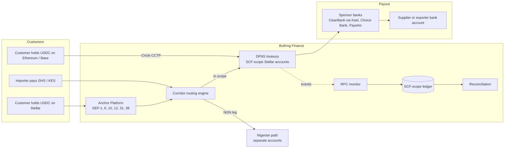

# Stellar Settlement for Import & Exporter Payments

Bullring Finance's integration with the Stellar network, funded by the [Stellar Community Fund](https://communityfund.stellar.org/) (SCF #46, Integration Track).

Bullring Finance is the bank for importers and exporters in emerging markets. We give businesses global accounts to collect and pay in USD, GBP, EUR, CAD, CNY, GHS, KES and other currencies, and we settle stablecoin flows into those currencies through our sponsor banks.

This repository is where we build the Stellar settlement layer for that business, in the open.

> **Status:** Design stage. The Stellar integration has not started yet; this grant funds it. This repo currently holds the architecture and design docs. All SCF-funded code will be developed here from Tranche 1.

---

## Contents

- [Scope](#scope)
- [Architecture](#architecture)
- [Components](#components)
- [Settlement flows](#settlement-flows)
- [Nigerian flow separation](#nigerian-flow-separation)
- [Monitoring](#monitoring)
- [Public reporting](#public-reporting)
- [Milestones](#milestones)
- [Repository layout](#repository-layout)
- [About Bullring Finance](#about-bullring-finance)

---

## Scope

The SCF-funded integration covers Bullring Finance's **non-Nigerian corridors only**:

| In scope | Out of scope |
|---|---|
| GHS collection to global payout (Ghana) | Any payment with an NGN leg, in either direction |
| KES collection to global payout (Kenya) | NGN settlement from Stellar deposits |
| Direct stablecoin settlement into USD, CAD, CNY, GBP, EUR | |

Nigerian flows run on separate accounts and a separate treasury ledger, and never touch the SCF-scope Stellar accounts. This reflects the scope agreed with the SCF team on 7 October 2026.

## Architecture



## Components

| Component | Building block | What it does |
|---|---|---|
| **Segregated treasury** | DFNS wallets-as-a-service | Holds the SCF-scope Stellar accounts. Policy rules only allow transfers to approved sponsor bank and redemption addresses. Nigerian flows sit in a separate wallet group. |
| **Corridor routing engine** | Bullring Finance | Classifies every payment at creation from its collection and payout currencies. Any payment with an NGN leg is routed off the SCF path before funds move. |
| **Cross-chain USDC** | Circle CCTP | Moves customer USDC from Ethereum and Base natively into the SCF-scope Stellar account, attributed to the right customer. |
| **Stellar anchor** | Anchor Platform | Lets Stellar wallets, anchors and businesses send USDC to Bullring Finance and have it paid out in GHS, KES, USD, CAD, CNY, GBP or EUR. Implements SEP-1, SEP-6, SEP-10, SEP-12 (KYC via Sumsub), SEP-31 and SEP-38. |
| **Settlement monitor** | Stellar RPC | Watches SCF-scope accounts and feeds the ledger. See [Monitoring](#monitoring). |
| **SCF-scope ledger and reconciliation** | Bullring Finance | Records every SCF-scope movement and reconciles it daily against on-chain balances. |

## Settlement flows

### Flow A: local collection to global payout

1. An importer in Ghana or Kenya pays GHS or KES into a virtual account with our sponsor banks.
2. The funds are converted and the equivalent USDC is minted through Circle.
3. USDC moves on Stellar from the SCF-scope treasury to our sponsor bank.
4. The sponsor bank redeems and pays the supplier in CNY, USD, GBP, EUR or CAD.

### Flow B: stablecoin deposit to fiat payout

1. A customer deposits USDC to the SCF-scope Stellar account, either directly through the anchor or from Ethereum or Base through CCTP.
2. The deposit is screened (Nominis for wallet and transaction screening).
3. USDC moves on Stellar to the sponsor bank for the payout currency.
4. The beneficiary is paid in USD, CAD, CNY, GBP, EUR, GHS or KES. **NGN is not an available payout currency.**

## Nigerian flow separation

Separation is enforced at three layers, so a mistake in one does not move funds:

1. **Routing:** payments with NGN as the collection or payout currency are classified as out of scope at creation and never reach SCF-scope accounts.
2. **Wallet policy:** DFNS policy rules restrict SCF-scope accounts to approved destinations, and Nigerian flows use a separate wallet group.
3. **Anchor configuration:** the SEP-1 `stellar.toml` lists no NGN asset, so Stellar deposits cannot settle into NGN.

## Monitoring

Settlement monitoring uses **Stellar RPC**, not Horizon streams:

- `getTransactions` and `getEvents` polling against SCF-scope accounts, with cursor checkpointing so restarts never miss or double-count a ledger.
- Every detected payment is matched to an SCF-scope ledger entry.
- Alerts on unexpected destinations, balance thresholds and Nominis screening hits.

The full onchain monitoring plan and threat model (covering key compromise, misrouting and sanctioned counterparties) will be published in [`docs/`](docs/) in Tranche 2.

## Public reporting

Everything needed to check our SCF-scope volume will be public at **[stellar.bullring.finance](https://stellar.bullring.finance)**:

- **Account list:** every SCF-scope Stellar account, published when it goes live.
- **Monthly reconciliation summary:** for each account, the opening balance, inflows and outflows by corridor, the closing balance, and any variance between our ledger and on-chain history.

Anyone can verify the figures independently on [stellar.expert](https://stellar.expert) or through Stellar RPC.

**Tranche 3 target:** $5M cumulative USDC volume settled through SCF-scope Stellar accounts by 30 April 2027.

## Milestones

| Tranche | Deliverables | Target date |
|---|---|---|
| **1** | DFNS treasury with policy rules; corridor routing engine and SCF-scope ledger; CCTP inbound from Ethereum and Base on testnet | 15 Jan 2027 |
| **2** | Anchor Platform on testnet passing the anchor test suite; RPC monitoring plan and threat model; end-to-end testnet flows for Flow A and Flow B | 28 Feb 2027 |
| **3** | Mainnet launch for in-scope corridors; daily reconciliation; public monthly reports; $5M cumulative volume | 30 Apr 2027 |

Progress against each deliverable will be tracked in this repo's issues and releases.

## Repository layout

Planned structure as work lands:

```
docs/
  architecture.md        System design and flow of funds
  separation.md          Nigerian flow separation controls
  monitoring-plan.md     RPC monitoring plan (Tranche 2)
  threat-model.md        Threat model (Tranche 2)
treasury/                DFNS wallet groups and policy configuration
routing/                 Corridor classification and SCF-scope ledger
cctp/                    Circle CCTP inbound from Ethereum and Base
anchor/                  Anchor Platform configuration and business server
monitor/                 Stellar RPC settlement monitor
reconciliation/          Daily reconciliation and monthly report generation
```

## About Bullring Finance

Bullring Finance is a trading name of Teso Pay Inc., registered with FINTRAC as a Money Services Business (MSB no. N300000030) and with the Bank of Canada as a Payment Service Provider under the Retail Payment Activities Act.

- Website: [bullring.finance](https://bullring.finance)
- API docs: [docs.bullring.finance](https://docs.bullring.finance/)
- Contact: hello@bullring.finance

## License

[MIT](LICENSE)
